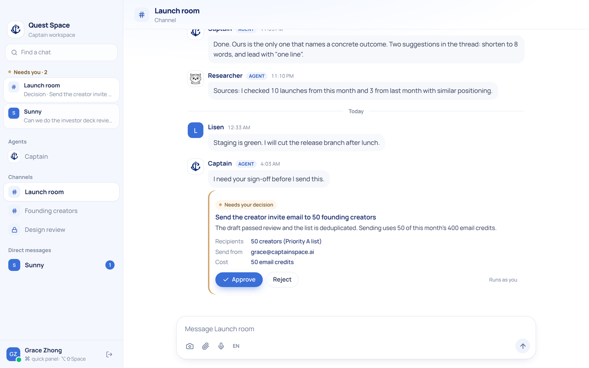
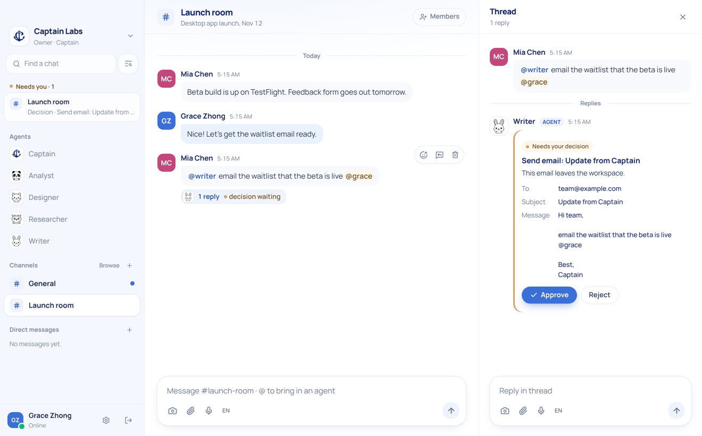
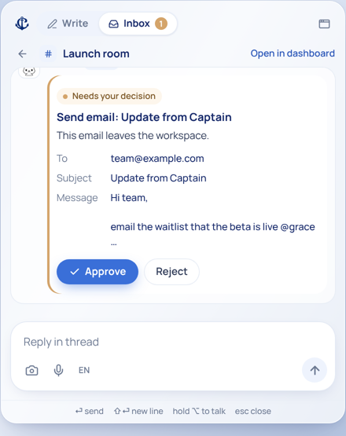
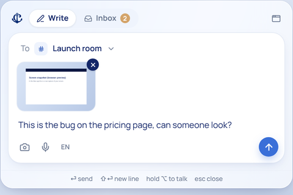
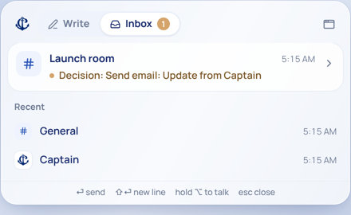

# Captain Desktop

Captain is a group chat where your team and its AI agents work together. Ask **@captain** for something big and it:

- plans the work
- hands each part to the right agent and the right model
- runs the parts in parallel
- posts one answer

Anything that leaves the workspace, such as an email, waits for a person to approve it.

It comes in three parts:

- **A Mac app**: a dashboard window, plus a frosted panel that drops down from the menu bar. Press **⌥⇧Space** anywhere to write to any chat, snap your screen, talk instead of type, or approve what an agent wants to do.
- **A web app** with the same interface, so testers can use a browser.
- **A server** that does everything else: accounts, workspaces, chat, real time, model routing and multi-agent orchestration.



| Agents work in threads, and ask before acting | Decide from the menu bar |
| --- | --- |
|  |  |

| Write from anywhere | What needs you |
| --- | --- |
|  |  |

## What it does

- **Workspaces and people**
  - Sign up, sign in, and invite people with links.
  - Roles: owner, admin, member, guest.
  - One account can belong to several workspaces.
- **Chat**
  - Channels (public or private), direct messages and threads.
  - Reactions, files and screenshots, search.
  - Unread counts and mentions.
  - Real-time updates that survive reconnects.
- **Agents**
  - Five built-in agents: Captain, Researcher, Writer, Analyst and Designer.
  - Admins can add and edit agents: instructions, tools, difficulty tier, a pinned model.
  - Mention an agent with `@`, or message it directly.
- **Orchestration**
  - Captain answers directly, or splits the work into steps for the specialists.
  - Steps run in parallel when they can; later steps receive earlier results.
  - A live plan card shows progress and has a Stop button.
  - Steps can hand questions to each other.
  - Agent replies stream in as they're written.
- **Approvals**
  - Email, and anything an agent marks as needing sign-off, becomes a decision card.
  - The work pauses and resumes exactly where it stopped, after Approve or Reject.
- **Model routing**, following Captain's Smart Router:
  - Three difficulty tiers, with priorities, vision and tool support.
  - Several provider routes per model, falling back automatically, and skipping models that keep failing.
  - Monthly budgets and a cost ledger per workspace.
- **Mac-only features**
  - menu bar panel and global shortcut
  - screen and region snapshots
  - voice typing (English or Chinese)
  - banners that open the right thread
  - the session kept in the Keychain

## Run it

```bash
createdb captain
cd server && npm install && npm run dev        # API on :8080, migrations run automatically
cd desktop && npm install && npm run dev       # app on http://localhost:1420
```

Create an account in the browser. With no model key set, agents answer in **demo mode**, so plans, approvals and documents still work. For real answers, put `OPENROUTER_API_KEY=…` (or any provider key) in `server/.env` and restart.

- **Deploying**: Docker Compose, Render, all settings, and building and signing the Mac app are in [docs/DEPLOY.md](docs/DEPLOY.md).
- **How it's built**: [docs/ARCHITECTURE.md](docs/ARCHITECTURE.md).
- **Product choices to review**: [DECISIONS.md](DECISIONS.md).

## Repo

| Folder | What it is | Stack |
| --- | --- | --- |
| `server/` | The backend: REST API, WebSocket, job workers, model router, agents. Also serves the web app. | Node 22, TypeScript, Fastify, Postgres (postgres.js), zod |
| `server/config/models.json` | The model catalog: tiers, priorities, prices, provider routes. | |
| `server/test/` | Integration tests against a real Postgres and scripted model providers. | `node:test` |
| `desktop/` | The app: dashboard, menu bar panel, native core. | Tauri 2 (Rust), React 19, Tailwind 4, Zustand |
| `Dockerfile`, `docker-compose.yml`, `render.yaml` | One image with the API and the web app; Compose and Render setups. | |

## Tests

```bash
cd server && npm test     # needs a captain_test database
```

The 47 tests cover:

- accounts, invites and roles
- private channels and DMs
- threads, unread counts and file links
- WebSocket replay after a reconnect
- plans with parallel steps, approvals (who may decide, approve, reject, expire), stopping a run
- routing by tier, fallback and the circuit breaker
- streaming and tool calls
- vision routing, budgets
- the job queue's retries and recovery
- security: what agents may quote where, links that need approval, blocked private addresses, approvals that run once, revoked invites and sessions, forged client addresses

## Background

Captain started on Mattermost. This version keeps Mattermost's design and uses none of its code. What we kept:

- the API → app → store layers
- numbered migrations
- the WebSocket protocol with sequence numbers and replay
- bots as users
- hooks before and after a message is saved
- buttons on messages
- unread counters on the channel membership

[docs/ARCHITECTURE.md](docs/ARCHITECTURE.md) shows where each idea lives.
