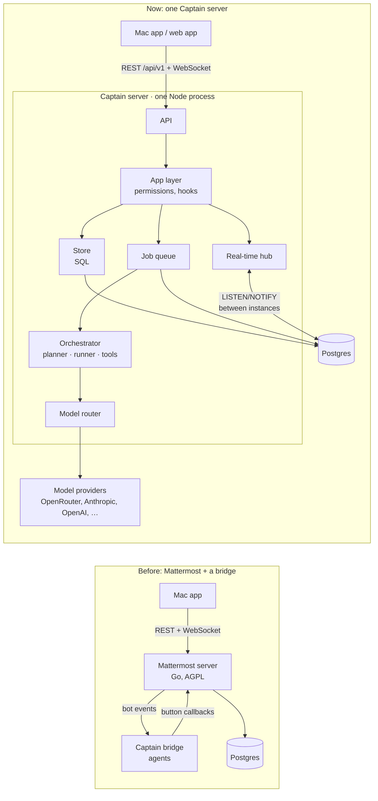
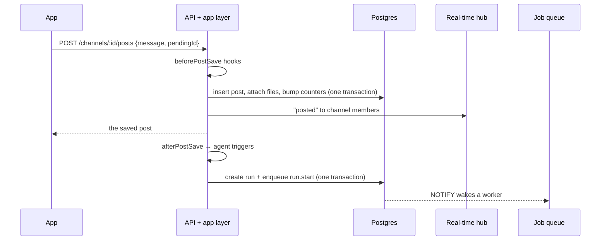
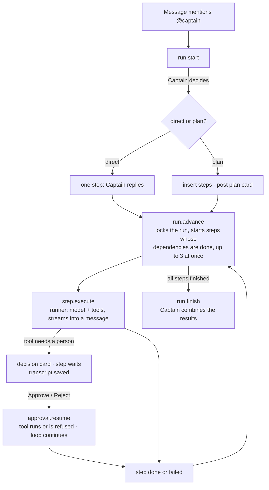

# Architecture

Captain is one server and one app.

- **The server** (`server/`) is a TypeScript service on Postgres. It handles accounts, workspaces, chat, real-time updates, model routing and multi-agent orchestration.
- **The app** (`desktop/`) is React. It runs in the Mac app (Tauri), which adds the menu bar panel, the global shortcut, screen snapshots, banners and the Keychain. The same app also runs as the web app the server hosts at `/`.

The server copies how Mattermost is built: its layers, its real-time protocol, and the way it treats bots and message hooks. It uses none of Mattermost's code.

## Before and after

## The Mattermost ideas we copied

| Mattermost | Captain | Where |
| --- | --- | --- |
| Layers: `api4` → `app` → `store` | Same three layers. Routes only parse input, the app layer checks permissions and runs the logic, and the store holds the SQL. | `src/api/`, `src/app/`, `src/store/` |
| Numbered SQL migrations with a ledger | `0001_init.sql` and up. They're applied at startup under an advisory lock, and checksums stop anyone from editing an applied migration. | `src/db/migrate.ts` |
| Retrying serialization and deadlock errors | `tx()` retries on 40001 and 40P01. | `src/db/index.ts` |
| 26-character ids, millisecond timestamps, soft deletes | Same. | `src/util/ids.ts` |
| WebSocket: authenticate with the first message, sequence numbers, reconnect with `connection_id` and `sequence_number` for a lossless replay | Same. The last 256 events are kept for 2 minutes. Typing and streaming text are "droppable": a slow client skips them, and they're never replayed. | `src/realtime/hub.ts`, `desktop/src/lib/socket.ts` |
| Cluster messages between servers | Postgres `LISTEN/NOTIFY`, with an outbox table for payloads larger than 7 KB. | `src/realtime/cluster.ts` |
| Bots are users | Each agent has a bot account (`is_bot`) that's a workspace member. Agents can be mentioned, messaged, and added to channels like people. | `src/agents/builtins.ts` |
| Plugin hooks `MessageWillBePosted` / `MessageHasBeenPosted` | `beforePostSave` (rewrite or reject) and `afterPostSave` (fire-and-forget; this is where agents start). | `src/app/hooks.ts` |
| Interactive message buttons (post actions) | `POST /posts/:id/actions/:action`, handled by post type. Decision cards use it. | `src/app/posts.ts` → `action` |
| Unread counts on the channel membership (`msg_count`, `mention_count`) | Same. Badges never count posts. | `src/store/channels.ts` → `recordPost` |
| `pending_post_id` for optimistic sends | `pendingId`, echoed back so the app swaps in the real message. | `src/app/posts.ts`, `desktop/src/lib/send.ts` |
| Jobs server | A Postgres job queue: `FOR UPDATE SKIP LOCKED`, leases with heartbeats, retries with backoff, dedupe keys, NOTIFY wake-ups. | `src/jobs/queue.ts` |
| Teams | Workspaces, with roles owner / admin / member / guest and invite links. | `src/app/workspaces.ts` |

## What a message does

## A run, start to finish

Every agent task is a **run**, and every run has **steps**. A plain reply is a run with one step, so pausing for approval, stopping and resuming work the same way everywhere.

- **Planner** (`agents/planner.ts`): Captain answers in JSON, either `{"mode":"direct"}` or a list of steps with `dependsOn`. The plan is checked before it runs: known agents only, unique ids, dependencies that exist, and no cycles. If planning fails, Captain answers directly.
- **Runner** (`agents/runner.ts`): calls the router and streams text to the chat as droppable `post_stream` events, at most every 120 ms. It runs tools and feeds their results back to the model. An *external* tool (email, `request_approval`) makes it stop, post a decision card, and return its transcript. The transcript is saved on the step, so the work picks up exactly where it stopped.
- **Context** (`agents/history.ts`): the thread, the recent DM, or recent channel messages as background, plus images and text files. Agents read only what the person who asked can read.
- **Jobs**: each phase is a durable job. If a server dies mid-step, its lease runs out and another server reruns the step. The half-written message is marked as interrupted.

## Model router

`llm/router.ts`, `llm/catalog.ts`, `config/models.json`, following Captain's Smart Router:

1. **Tier.** Each call gets a tier: easy, balanced or hard. An agent's own tier is the floor (Analyst is "hard"), and "auto" lets the request decide. Heuristics in `llm/classify.ts` raise the tier for long or demanding requests. A cheap-model classifier is optional.
2. **Candidates.** The router lists the tier's models by priority, then lower tiers, then higher ones. It keeps only models that can see images when images are attached, and that support tools when tools are offered. A model pinned on the agent goes first.
3. **Routes.** Each model has provider routes in order: the vendor, then OpenRouter, then a gateway. A route is used only if its provider has a key. Keys come from Settings (`llm/keys.ts`: encrypted in `provider_keys`, reloaded on every instance through `NOTIFY captain_keys`) or else from the environment. A model and provider pair that fails 3 times is skipped for 2 minutes; changing a provider's key clears that.
4. **Ledger.** Every attempt is written to `usage_events` with tokens, cost, latency and the run and step. If a workspace is over its monthly budget, the call is refused with a 402 before any model is called.
5. **Demo.** With no key configured, a built-in demo model answers. It follows the same protocol, including streaming, tool calls and plan JSON.

All providers are called with the OpenAI-compatible `/chat/completions` format and streaming server-sent events (`llm/client.ts`).

## Data

Tables, created by the numbered files in `src/db/migrations/`:

- people and access: `users` (`instance_admin` marks who runs the server), `sessions`, `password_resets`, `workspaces`, `workspace_members`, `invites`
- chat: `channels`, `channel_members`, `posts` (with a generated full-text `search` column), `reactions`, `files`
- agents: `agents`, `runs`, `run_steps`, `approvals`
- models: `usage_events`, `provider_keys` (encrypted keys pasted in Settings)
- infrastructure: `jobs`, `realtime_outbox`, `audit_log`

After migrating, the server turns on row-level security for every table in `public`, with no policies. On Supabase this keeps the Data API from serving them; the server itself connects as the tables' owner and isn't affected.

Special message types:

- `plan`: a plan card, with `props.plan`
- `decision`: a decision card, with `props.decision`
- `agent_step`: a step's output, with `props.step`

Agent messages carry `props.model` (the model id, provider, tier and cost) and, while they're being written, `props.streaming`.

## The app

- `desktop/src/lib/api.ts` handles REST calls.
- `socket.ts` manages the WebSocket: authentication, replay, and a resync when replay isn't possible.
- `store.ts` is one Zustand store per window.
- `realtime.ts` applies events, raises banners and sets the badge. In the Mac app, the dashboard window owns the only socket and relays its events to the panel window.
- The Rust core (`desktop/src-tauri/src/lib.rs`) handles everything native:
  - the menu bar icon and its badge
  - the ⌥⇧Space shortcut
  - the frosted panel under the icon
  - `screencapture` snapshots
  - notification banners that open the right thread
  - the Keychain, which stores the session

## Scaling and availability

- **More users:** run more copies of the server behind a load balancer. WebSockets don't need sticky sessions, because events reach every instance over NOTIFY. Each instance also runs agent workers; `WORKER_CONCURRENCY` sets how many jobs each one takes.
- **Agents slowing the API down:** run the same image twice, once with `WORKERS=false` (API only) and once as a workers-only service with no public port.
- **A server dies:** its WebSocket clients reconnect to another instance. Within 2 minutes, a client on the same instance gets a replay; otherwise it reloads its state. Its jobs' leases expire after 90 seconds, and another instance takes them over.
- **Limits worth knowing:**
  - The rate limiter and the circuit breaker live in memory on each instance.
  - Uploads live on a disk. Move them to S3 before running more than one instance, or mount shared storage.
